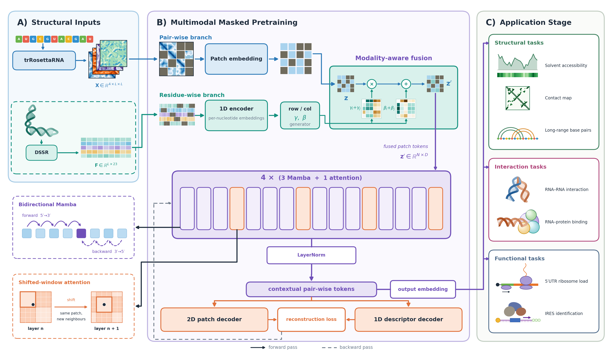
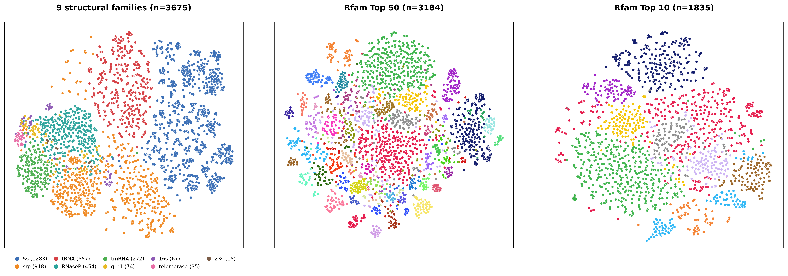
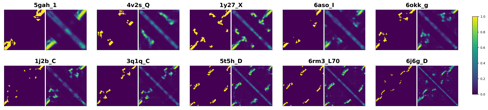

<div align="center">

# RNAtomy

### A Structure-Aware RNA Foundation Model for Transferable Structural and Functional Representations

[](https://www.python.org/)
[](https://pytorch.org/)
[](https://doi.org/10.5281/zenodo.23968854)
[](#applications)
[](LICENSE)




</div>

**RNAtomy** is a self-supervised RNA foundation model that learns the structural *anatomy* of RNA from
**inter-nucleotide geometry** and **residue-level conformational descriptors**. It is pretrained once on ~200K RNAs from RNAcentral, and the resulting encoder is reused,
frozen or fine-tuned, for structural, interaction, and functional tasks.

Three design choices set it apart:

1. **Joint masked reconstruction** of a pairwise geometry tensor (one distance and three orientation channels
   from trRosettaRNA) and a residue-wise descriptor matrix (23 DSSR features per nucleotide), which ties
   spatial organization to local conformation.
2. **A hybrid Mamba–Transformer backbone.** Bidirectional Mamba blocks carry context across the whole
   pairwise map, and shifted-window attention blocks add content-dependent interactions inside local regions
   of the map, which Mamba alone does not model.
3. **Axis-aware feature-wise linear modulation.** Nucleotide-level conformations modulate the row and column axes of the pairwise tokens
   separately, so position (*i*, *j*) is distinguished from (*j*, *i*).

## Table of Contents

1. [Three ways to use RNAtomy](#three-ways-to-use-rnatomy)
2. [Installation](#installation)
3. [Pretrained weights and data](#pretrained-weights-and-data)
4. [Extract embeddings](#quick-start-extract-embeddings)
5. [Preparing inputs for your own RNAs](#preparing-inputs-for-your-own-rnas)
6. [Embedding space](#embedding-space)
7. [Pretraining](#pretraining)
8. [Applications](#applications)
9. [Results](#results)
10. [Limitations](#limitations)
11. [Repository layout](#repository-layout)
12. [Citation](#citation)
13. [License](#license)
14. [Contact](#contact)


## Three ways to use RNAtomy

The encoder is pretrained once and shared by all tasks. How it is used on top of that depends on the amount of
labelled data and the accuracy required:

| Setting | Backbone | Trained | Suitable when |
|---|---|---|---|
| **1. Embeddings** | frozen | nothing, or a scikit-learn model on the vectors | features are needed for clustering, retrieval or a quick baseline |
| **2. Frozen backbone + light head** | frozen | a small task head | labels are scarce, or the goal is to measure how much the embedding already encodes |
| **3. Full fine-tuning** | trainable | head and encoder together | enough labels are available and the highest accuracy is needed |

Settings 2 and 3 are implemented by the scripts in [Applications](#applications). Setting 1 is
[`embed.py`](embed.py).


## Installation

RNAtomy needs a CUDA GPU because the Mamba blocks use the `mamba_ssm` kernels.

```bash
conda create -n rnatomy python=3.10 -y
conda activate rnatomy

# PyTorch >= 2.0 matching your CUDA version: https://pytorch.org/get-started/locally/
pip install torch --index-url https://download.pytorch.org/whl/cu121

# Mamba kernels, then the remaining dependencies
pip install causal-conv1d mamba-ssm
pip install -r requirements.txt
```

DSSR is required only to compute the residue-wise descriptors for your own RNAs. It is distributed separately
under its own licence: <http://x3dna.org/>.


## Pretrained weights and data

Weights and pretraining data are archived on Zenodo: **[10.5281/zenodo.23968854](https://doi.org/10.5281/zenodo.23968854)**
(CC BY 4.0).

| File | Size | Contents |
|---|---|---|
| `rnatomy.pth` | 1.2 GB | pretrained RNAtomy checkpoint |
| `fasta.zip` | 90.8 MB | sequences of the pretraining RNAs, one FASTA file per RNAcentral ID |
| `1d_feats.zip` | 943.7 MB | residue-wise DSSR descriptors (`feat1d_norm.npy`) |
| `2d_maps_examples.zip` | 101.1 MB | 70 example trRosettaRNA maps (`L × L × 4`) |
| Complete 2D maps | ≈ 130 GB | trRosettaRNA maps of the full pretraining set, available on request |

**Complete pairwise maps.** The maps for the full pretraining set total about 130 GB, which exceeds the size limit of
public archives such as Zenodo. To support re-pretraining, ablations, and reproduction of the reported results, we provide the complete maps on request at [ashir018@fiu.edu](mailto:ashir018@fiu.edu). The maps can also be regenerated from `fasta.zip` with
[trRosettaRNA](https://yanglab.qd.sdu.edu.cn/trRosettaRNA/).


## Extract embeddings

```python
import numpy as np
from embed import load_encoder, embed

enc = load_encoder("pretraining_model/pretrained_model/rnatomy.pth")

pair_map = np.load("2d_maps_examples/_URS0000003E31.npy")        # [L, L, 4] trRosettaRNA maps
feats = np.load("1d_feats/URS0000003E31/feat1d_norm.npy")        # [L, 23] DSSR descriptors

rna = embed(enc, pair_map, feats, level="pooled")                # [768]
nts = embed(enc, pair_map, feats, level="nucleotide")            # [L, 768]
pairs = embed(enc, pair_map, feats, level="pair")                # [L, L, 768]

rna_2d_only = embed(enc, pair_map, None, level="pooled")         # pairwise map alone, no descriptors
```

The same from the command line, for a folder of maps:

```bash
python embed.py --ckpt pretraining_model/pretrained_model/rnatomy.pth \
    --maps 2d_maps_examples --feat1d-root 1d_feats --level pooled --out embeddings.npz
```

`embeddings.npz` holds `ids` and `embeddings` (`N × 768`). With `--level nucleotide` or `pair`, `--out` is a folder that
receives one `<id>.npy` per RNA. Without `--feat1d-root` the encoder uses the pairwise map alone. Maps are
normalized with the pretraining statistics inside `embed()`, so pass raw trRosettaRNA values. RNAs longer than
1,024 nt are processed in overlapping windows whose outputs are averaged (not available for `pair`).

For batched or trainable use, `models/rna_encoder.py` exposes the same four outputs with padding masks:
`encode_pooled`, `encode_tokens`, `encode_pairs`, `encode_nucleotides`, plus `freeze()`,
`unfreeze_last_n_blocks(n)` and `unfreeze_all()`.

## Preparing inputs for your own RNAs

RNAtomy needs only a sequence. Two files per RNA are derived from it by existing tools:

| Step | Tool | Output |
|---|---|---|
| 1. Pairwise geometry | [trRosettaRNA](https://yanglab.qd.sdu.edu.cn/trRosettaRNA/) | `<id>.npy`, `L × L × 4`: one distance channel and three orientation channels (the orientations are directional, so the map is not symmetric) |
| 2. Predicted 3D model | trRosettaRNA | a PDB file per RNA |
| 3. Residue descriptors | DSSR on the model, via `Final_extacting_dssr.py` | `<id>/feat1d_norm.npy`, `L × 23` |

```bash
# DSSR descriptors for every PDB in ./training_set (writes ./out/<RNA>/feat1d_norm.npy)
python Final_extacting_dssr.py
```

The 23 descriptors are, in column order: sine and cosine of the six backbone torsions α, β, γ, δ, ε, ζ (1–12) and of
χ (13–14), the continuous phosphate descriptors `ssZp` and `Dp` (15–16), and seven binary indicators (17–23):
`is_paired`, `in_stem`, `in_helix`, `in_junction`, `in_hairpin`, `in_bulge`, `in_iloop`.

The descriptor track is optional at inference. The model was pretrained with modality dropout, so it runs on the
pairwise map alone when DSSR output is not available.

> **Provenance matters.** Both inputs should be computed from *predicted* structures. If a benchmark's
> labels come from experimental structures (for example contact maps or solvent accessibility), do not derive the
> descriptors from those same experimental structures, or the label leaks into the input.

## Embedding space

Mean-pooled RNAtomy embeddings, with no task training, organize RNAs by family. Left: nine structural families from
ArchiveII. Middle and right: the 50 and 10 most populated Rfam 15.0 families. The projection is t-SNE, and
families are used only to color the points.




## Pretraining

**Data.** Sequences come from the RNAcentral active release (40.7M sequences). They were assigned to RNA categories by
keyword matching, sampled to over-represent rarer classes, clustered with CD-HIT-EST at 95% identity (80% coverage),
and filtered to 50–1,024 nt with complete structural features. The result is 200,158 RNAs, split 180,142 for
training and 20,016 for validation.


**Run:**

```bash
torchrun --nproc_per_node 4 pretraining_model/pretrain.py \
    --data-path <dir with train/ and val/ holding <id>.npy maps> \
    --feat1d-root <dir with <id>/feat1d_norm.npy> \
    --output_dir runs/pretrain
```

The defaults of `pretrain.py` are the settings of the released model. Run `python pretraining_model/pretrain.py -h` for
all options.

| Setting | Value |
|---|---|
| Patch size / width / blocks | 8 × 8 / 768 / 16 |
| Pairwise masking | ratio drawn from U(0.45, 0.65); signal-aware weights with α = 1.0 |
| Residue-wise masking | 15% of nucleotides in spans of 4 |
| Modality dropout | 0.3 (descriptor track withheld for the whole RNA) |
| Loss weight | λ_1D = 0.5 |
| Batch | 16 per GPU × 2 accumulation steps × 4 GPUs = 128 |
| Optimizer | AdamW, peak learning rate 2e-4, weight decay 0.05, 20 warm-up epochs, cosine decay, gradient clip 1.0 |
| Length curriculum | maximum length grows from the 40th to the 100th percentile over 30 epochs |
| Batching | token-bucket batches with a length-adaptive token budget |
| Precision / checkpoint | FP32; validation and checkpoint selection use EMA weights |

The objective is `L = L_2D + λ_1D · L_1D`:

- `L_2D` reconstructs the standardized distance and orientation values of masked patches, weighted so that patches with
  a strong geometric signal are not drowned out by background.
- `L_1D` reconstructs the 23 descriptors of masked spans: a cosine loss on the sine/cosine angles, a Huber loss on the
  continuous descriptors and binary cross-entropy on the structural indicators.


## Applications

Every task script loads the pretrained encoder (`--pretrain-ckpt`), attaches a task head, and trains the head alone
(`--freeze-backbone`, RNAtomy-FB), the last *n* blocks, or the full network (RNAtomy). Validation picks the best
epoch, and the test set is evaluated once.

| # | Task | Script | Level |
|---|---|---|---|
| 1 | Solvent accessibility | `finetune_rsa.py` | nucleotide |
| 2 | 3D contact maps | `finetune_contact_map.py` | nucleotide pair |
| 3 | Long-range base pairs | `finetune_lrbp.py` | nucleotide pair |
| 4 | RNA–RNA interaction | `finetune_rri.py` | RNA pair |
| 5 | RNA–protein binding | `finetune_rna_protein.py` | nucleotide / RNA |
| 6 | 5′UTR ribosome load | `finetune_utr_mrl.py` | RNA |
| 7 | IRES identification | `finetune_ires.py` | RNA |

Example: contact-map prediction with a frozen backbone.

```bash
python finetune_contact_map.py \
    --pretrain-ckpt pretraining_model/pretrained_model/rnatomy.pth \
    --train-split data/train.fasta --val-split data/val.fasta --test-split data/test.fasta \
    --train-npy-root data/train/npy --val-npy-root data/val/npy --test-npy-root data/test/npy \
    --train-feat1d-root data/train/dssr --val-feat1d-root data/val/dssr --test-feat1d-root data/test/dssr \
    --contact-root data/contact_maps \
    --norm-mean "28.472,93.731,89.640,-8.994,0.0" --norm-std "6.018,15.843,22.327,21.095,1.0" \
    --head-input pair --focal-alpha 0.5 --focal-gamma 2.0 \
    --freeze-backbone --unfreeze-last-n-blocks 0 \
    --lr 1e-5 --epochs 200 --early-stop-patience 15 \
    --output-dir runs/contact
```

Re-evaluate a trained head without training: add `--resume runs/contact/checkpoint_best.pth --eval-only`.
Every script documents its own arguments and data format at the top of the file (`python finetune_<task>.py -h`).

Downstream benchmarks are public. Please cite the original benchmark papers when you use them.


### Predicted contact maps

Ten RNAcontact test RNAs chosen by stratified random sampling over the length distribution, without looking at
performance. For each pair, the ground truth is on the left and the RNAtomy contact probability on the right. Only
pairs with |i − j| ≥ 24 are labelled and scored, so the signal near the diagonal is not part of the evaluation.




## License

Code is released under the [MIT License](LICENSE). The weights and data on Zenodo are released under CC BY 4.0.
DSSR, trRosettaRNA and the third-party benchmarks keep their own licenses.

## Contact

**Azam Shirali**, Bioinformatics Research Group (BioRG), Knight Foundation School of Computing and Information
Sciences, Florida International University
📧 [ashir018@fiu.edu](mailto:ashir018@fiu.edu)

